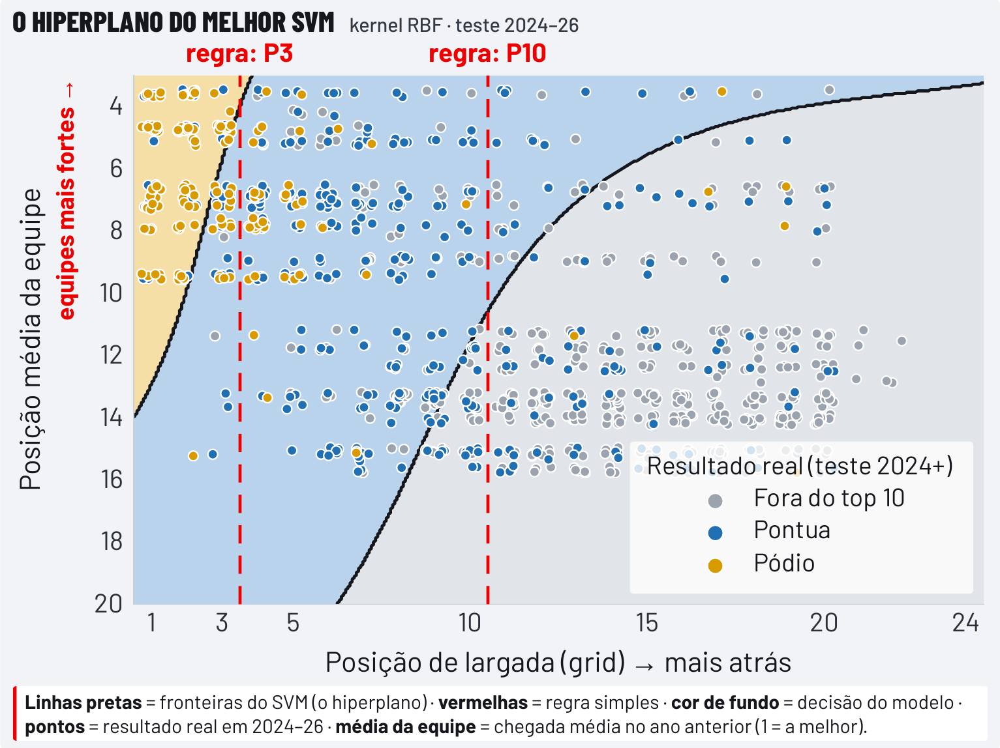
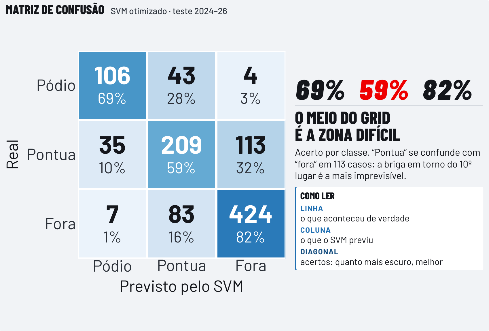

# Classificação de resultados da Fórmula 1 com SVM

[](https://github.com/Nicolas-Mariano/f1-classificacao-svm/actions/workflows/testes.yml)


[](LICENSE)

Dá para prever, antes da largada, se um piloto vai terminar no pódio, nos pontos ou fora do top 10? Treinamos um Support Vector Classifier com 6.977 resultados da era moderna da Fórmula 1 e o comparamos com uma regra simples: cada piloto termina na mesma faixa em que largou.

> **Resultado principal:** o SVM otimizado ficou no mesmo nível da regra simples, com F1 macro de 0,70 contra 0,72 no teste. A posição de largada já concentra quase toda a informação disponível antes da corrida.

## Resultados

Avaliação nas temporadas de 2024 a 2026, com 1.024 resultados que o modelo nunca viu no treino.

| Modelo | F1 macro | Acurácia | F1 pódio | F1 pontua | F1 fora do top 10 |
| --- | ---: | ---: | ---: | ---: | ---: |
| Regra simples (só o grid) | **0,72** | **0,73** | **0,71** | **0,64** | **0,80** |
| SVM otimizado | 0,70 | 0,72 | 0,70 | 0,60 | **0,80** |
| SVM baseline | 0,67 | 0,68 | 0,67 | 0,56 | 0,77 |

<p align="center">
  
  
</p>

### O que aprendemos

- **O grid carrega quase toda a informação.** O SVM concorda com a regra simples em 85,9% das previsões.
- **A diferença entre os dois não é significativa.** Nos 144 casos em que discordam, a regra acertou 75 e o SVM acertou 65 (teste de McNemar exato, p ≈ 0,45).
- **O histórico da temporada anterior acrescenta pouco.** Ele é em grande parte redundante com o grid, que é uma informação mais atual.
- **Balancear as classes atrapalhou.** Com `class_weight='balanced'`, o modelo previu 252 pódios para 153 reais. Sem balanceamento, previu 148, e o F1 macro subiu de 0,67 para 0,70.
- **As fronteiras não são lineares.** O kernel RBF foi o melhor da busca, à frente do linear e do sigmoid.

## Como funciona

O dataset tem 25.939 resultados de 1950 a 2026, e o modelo usa os de 2010 em diante. Desde esse ano, os 10 primeiros pontuam, então a classe "pontua" corresponde ao sistema de pontos atual.

**Alvo:** pódio (1º ao 3º), pontua (4º ao 10º) ou fora do top 10 (11º em diante).

**Features:**

| Feature | Descrição |
| --- | --- |
| `grid` | Posição de largada |
| `media_piloto_ano_anterior` | Chegada média do piloto na temporada anterior |
| `media_equipe_ano_anterior` | Chegada média da equipe na temporada anterior |

**Modelo:** a busca testou 72 combinações de kernel, `C`, `gamma` e `class_weight`, com 5 folds de `TimeSeriesSplit`. A vencedora usa kernel RBF, `C=10`, `gamma=0.1` e nenhum balanceamento de classes.

### Decisões contra vazamento de dados

| Decisão | Motivo |
| --- | --- |
| Treino de 2010 a 2023 e teste de 2024 a 2026 | O modelo nunca usa o futuro para prever o passado |
| Histórico calculado só com a temporada anterior | A informação já existe antes da corrida |
| `position`, `points`, `laps` e `status` removidas | Esses dados só existem depois da bandeirada |
| Medianas e padronização ajustadas só no treino | O teste não influencia o modelo |
| Validação cruzada com `TimeSeriesSplit` | Cada fold treina no passado e valida no período seguinte |

### Tratamento dos dados

| Situação | Tratamento |
| --- | --- |
| Largada dos boxes (`grid = 0`) | Vira 30, para não parecer melhor que a pole |
| Equipes renomeadas | Unificadas, como Force India → Racing Point → Aston Martin |
| Estreantes e equipes novas | Recebem a mediana do treino |
| `time`, `fastest_lap` e `fastest_lap_rank` | Removidas, com menos de 35% dos valores preenchidos |

## Como reproduzir

Requer Python 3.10 ou superior.

```bash
git clone https://github.com/Nicolas-Mariano/f1-classificacao-svm.git
cd f1-classificacao-svm
python -m venv .venv
source .venv/bin/activate  # No Windows: .venv\Scripts\activate
pip install -e ".[dev]"
```

Baixe o dataset seguindo as instruções em [`data/README.md`](data/README.md) e rode o experimento:

```bash
python -m f1_svm
```

A busca faz 360 treinos e pode levar alguns minutos. O comando imprime a comparação entre os modelos e salva `metricas.json` e `matriz_confusao.png` na pasta `resultados/`.

Para rodar os testes:

```bash
pytest
```

Os testes usam dados sintéticos e rodam na integração contínua. Com o dataset em `data/raw/`, `pytest` também confere se o código reproduz os números do notebook e do pôster.

## Estrutura do repositório

```text
├── data/                 Instruções para obter o dataset
├── docs/                 Pôster e figuras
├── notebooks/            Experimento passo a passo, com as saídas do Kaggle
├── src/f1_svm/
│   ├── dados.py          Limpeza, alvo, histórico e divisão no tempo
│   ├── modelos.py        Regra simples, SVM baseline e busca de hiperparâmetros
│   ├── avaliacao.py      Métricas, comparação entre modelos e matriz de confusão
│   ├── experimento.py    Execução completa do experimento
│   └── __main__.py       Linha de comando
└── tests/                Testes das regras de negócio e contra vazamento
```

O [notebook](notebooks/f1_classificacao_svm.ipynb) explica o raciocínio de cada etapa. O pacote `f1_svm` traz a mesma lógica em módulos testáveis.

## Limitações

- **Previsões independentes:** o modelo classifica cada piloto isoladamente e não sabe que cada corrida tem exatamente 3 pódios e 7 pilotos pontuando. A regra simples respeita essa estrutura por construção.
- **Teste concentrado em 2024 e 2025:** o teste cobre 51 corridas, e 2026 entra só com o início da temporada.
- **Padronização antes da validação cruzada:** o padronizador é ajustado em todo o treino antes da busca, o que pode deixar o F1 de validação um pouco otimista. Mantivemos assim para reproduzir os números do pôster.
- **Folds divididos por linha:** o `TimeSeriesSplit` pode separar pilotos da mesma corrida entre treino e validação.

## Próximos passos

- Adicionar features que o grid não captura, como dificuldade de ultrapassagem da pista, clima e pneus.
- Testar um modelo que ordene os pilotos dentro de cada corrida, em vez de classificá-los um a um.
- Levar a padronização para dentro de um `Pipeline` e separar os folds por corrida.

## Pôster

Pôster da 4ª edição do UMC Summit. [Abrir em PDF](docs/poster-f1-svm.pdf).

<a href="f1-classificacao-svm/docs/poster-f1-svm.pdf"></a>

## Equipe

- **Autores:** Ana Raquel da Silva Correia e Nicolas Mariano de Azevedo
- **Orientadores:** Fabiano Bezerra e Higor Barreto
- **Curso:** Engenharia de Software, Universidade de Mogi das Cruzes

Dados: [Formula 1 Complete Dataset 1950-2026](https://www.kaggle.com/datasets/patelris/formula-1-complete-dataset-1950-2026), de `patelris`, no Kaggle.

## Licença

O código está sob a [licença MIT](LICENSE). O pôster, os logos e as marcas citadas pertencem aos respectivos titulares, e o dataset segue os termos definidos no Kaggle. Este é um projeto acadêmico independente, sem vínculo com a Fórmula 1.

## English summary

Can we predict, before the race starts, whether a Formula 1 driver will finish on the podium, in the points, or outside the top 10? We trained a Support Vector Classifier on 6,977 modern-era results, using only the starting grid and the previous season's driver and team performance. On the 2024–2026 test seasons, the tuned SVM reached a macro F1 of 0.70, on par with a simple rule based on the starting position alone (0.72). The grid already holds almost all the information available before the race.
